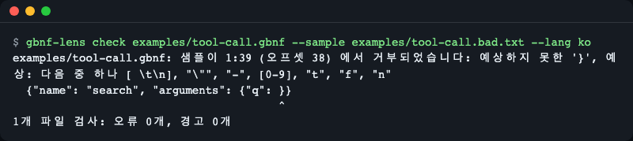
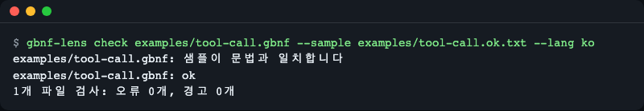
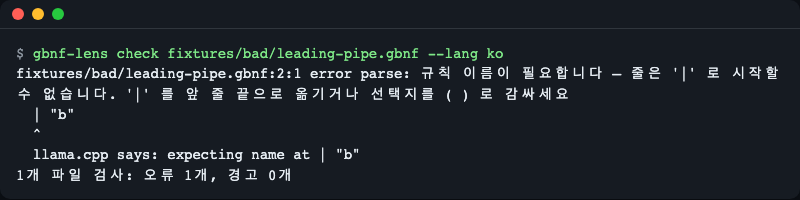
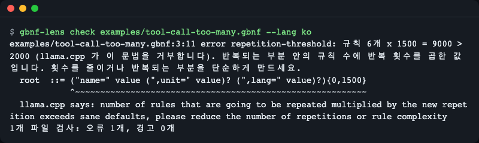
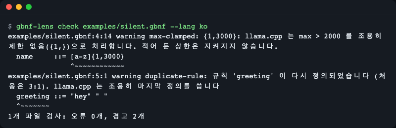
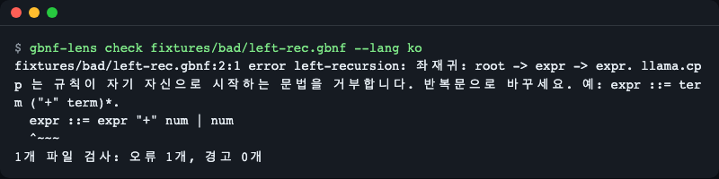
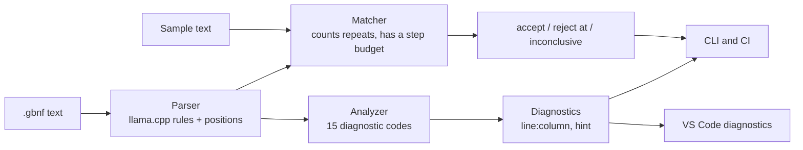

# gbnf-lens

[English](README.md) | **한국어**

llama.cpp GBNF 문법(로컬 LLM이 만들어 낼 수 있는 출력을 제한하는 문법 파일)을 서버에 보내기 전에 터미널·CI·VS Code에서 점검합니다. gbnf-lens 는 llama.cpp 의 파싱 규칙을 따른 판정, 줄·열 위치, llama.cpp 가 말없이 뜻을 바꾸는 곳에 대한 경고, 예시 문자열이 어디에서 문법과 어긋나는지를 알려 줍니다. 런타임 의존성이 없는 TypeScript 라이브러리, CLI, VS Code 확장입니다.


*문법과 맞지 않는 샘플: 위치(1:39), 그 자리에서 문법이 기대한 것, 문제 글자 아래의 캐럿(^).*

## 무엇을 더해 주나요

- **문법 오류에 위치를 붙입니다.** llama.cpp 는 `expecting name at ...` 같은 한 줄 메시지만 냅니다. gbnf-lens 는 `파일:줄:열`, 원본 줄, 고치는 힌트, llama.cpp 원문 메시지를 함께 보여 줍니다.
- **llama.cpp 가 받아 주지만 쓴 대로 동작하지 않는 곳을 경고합니다.** 같은 규칙을 두 번 정의(마지막 것이 이김), 최댓값이 2000 을 넘는 `{m,n}`(무제한으로 바뀜), 느려질 수 있는 `x? x? x?` 연쇄, 빈 문자열과 맞을 수 있는 것의 반복, 쓰이지 않는 규칙.
- **llama.cpp 가 로드할 때 거부하는 것을 오류로 알립니다.** 왼쪽 재귀(`root -> expr -> expr` 같은 규칙 경로로 표시), 반복 한도(반복되는 부분 안의 규칙 수 × 반복 횟수가 2000 이하여야 함), 너무 깊은 중첩.
- **샘플 매칭.** 예시 출력을 주면 문법이 받아 주는지, 아니면 어디서 왜 멈추는지 알려 줍니다. 큰 반복은 펼치지 않고 횟수만 세므로 `{0,2000}` 도 메모리가 늘지 않습니다.
- **라이브러리·CLI·VS Code 확장**이 런타임 의존성 없는 하나의 코어를 함께 씁니다.

모두 오프라인으로 동작합니다. 서버·GPU·API 키·네트워크가 필요 없습니다.

## 왜 만들었나

llama.cpp 는 잘못된 문법을 위치 없는 한 줄로만 알려 줍니다. 예: `expecting name at ...`([#11866](https://github.com/ggml-org/llama.cpp/issues/11866)). 스트리밍 요청이면 오류가 클라이언트에 아예 오지 않을 수도 있습니다([#7391](https://github.com/ggml-org/llama.cpp/issues/7391)). 반복 한도를 넘는 도구 호출 문법은 서버 오류로만 드러납니다([#20867](https://github.com/ggml-org/llama.cpp/issues/20867)). gbnf-lens 는 같은 검사를 요청을 보내기 전에 내 컴퓨터에서 하고 문제 위치를 출력합니다.

## 요구 사항

| 부분 | 확인한 버전 | 비고 |
|---|---|---|
| Node.js | 26.13.0, 20.20.2 (패키지는 `>=20` 선언, 2026-11-13 에 두 버전에서 `npm test` 전체 통과, CI 는 Node 20·22 로 실행) | CLI, 라이브러리, 확장 빌드에 필요 |
| npm | 11.20.0, 10.8.2 (위 Node 에 들어 있는 것) | 의존성은 개발용뿐: TypeScript 7.0.2, esbuild 0.28.2, `@types/node` 26.6.6, `@types/vscode` 1.90.0 |
| VS Code | 실제 에디터에서는 확인하지 못함 | 매니페스트는 `^1.90.0` 선언. 확장 로직은 VS Code 없이 테스트함([한계](#한계) 참고) |
| llama.cpp | 커밋 `af6b524` | `fixtures/llamacpp/cases.json` 에 기록된 기준 출력으로만 쓰이고 도구가 직접 실행하지 않음 |

## 설치

gbnf-lens 는 아직 npm 에 올라가 있지 않습니다. clone 해서 설치합니다.

```bash
git clone https://github.com/LeeGyeongPil/gbnf-lens.git
cd gbnf-lens
npm install      # "prepare" 스크립트가 dist/ 와 extension/dist/ 도 빌드합니다
```

동작 확인:

```console
$ node dist/cli.js check examples/tool-call.gbnf --lang ko
examples/tool-call.gbnf: ok
1개 파일 검사: 오류 0개, 경고 0개
```

PATH 에 `gbnf-lens` 명령을 두려면 clone 안에서 `npm link` 를 실행합니다. 아래 예시는 그것 없이도 되도록 `node dist/cli.js` 로 씁니다.

한 번에 훑어보려면 안내 투어(5단계, 항상 종료 코드 0)를 실행하세요.

```bash
npm run demo
```

## 사용법

### 명령줄

```bash
node dist/cli.js check <files...> [--sample <file>] [--sample-text <text>] [--json] [--strict] [--max-steps <n>] [--max-input <n>] [--lang en|ko]
```

**언어.** 메시지, 도움말, 요약 줄을 영어 또는 한국어로 볼 수 있습니다. 순서는 `--lang en|ko`, 그다음 `GBNF_LENS_LANG` 환경 변수, 그다음 `LC_ALL`, `LC_MESSAGES`, `LANG` 이며, 값이 `ko` 로 시작하면 한국어, 그 밖에는 영어입니다. `--lang` 은 `check` 앞에 와도 되고(`--lang ko check ...`, `--lang=ko check ...`) 뒤에 와도 됩니다. 값이 없거나 `en`·`ko` 가 아니면 어느 자리든 사용법 오류(종료 코드 2)이고, 오류 문구가 `--lang` 값을 가리킵니다. 이 오류 문구의 언어는 `GBNF_LENS_LANG`·`LANG` 을 따르므로, 한국어 환경(예: `LANG=ko_KR.UTF-8`)에서 `--lang check x` 는 `--lang 에는 'en' 또는 'ko' 가 필요합니다 (받은 값: 'check')` 를 출력합니다(영어 환경에서는 `--lang needs 'en' or 'ko', got 'check'`). `code`, `severity`, JSON 키는 바뀌지 않고, `llama.cpp says:` 뒤의 글은 llama.cpp 원문 그대로입니다. `--json` 의 `message` 는 고른 언어를 따릅니다.

```bash
node dist/cli.js check grammar.gbnf --lang ko
GBNF_LENS_LANG=ko node dist/cli.js check grammar.gbnf
```

아래 출력 예시와 스크린샷은 모두 `--lang ko` 로 실행한 한국어 화면입니다(영어 화면은 [README.md](README.md)). 스크린샷의 `gbnf-lens` 는 `npm link` 뒤의 같은 명령이고, 글 상자는 링크 없이 되는 `node dist/cli.js` 로 적었습니다.

| 종료 코드 | 뜻 |
|---|---|
| 0 | 오류 없음(경고는 출력되지만 실패하지 않음) |
| 1 | 오류, 거부된 샘플, 또는 `--strict` 일 때 경고 |
| 2 | 사용법 오류 또는 읽을 수 없는 파일 |

**깨끗한 문법과 그것이 받아 주는 샘플.**

```console
$ node dist/cli.js check examples/tool-call.gbnf --sample examples/tool-call.ok.txt --lang ko
examples/tool-call.gbnf: 샘플이 문법과 일치합니다
examples/tool-call.gbnf: ok
1개 파일 검사: 오류 0개, 경고 0개
```


*"샘플이 문법과 일치합니다" 와 "오류 0개, 경고 0개": 종료 코드 0, 고칠 것이 없습니다.*

**멈추는 샘플**(종료 코드 1). 위치, 코드 포인트 오프셋(llama.cpp 검증기와 같은 세는 방식), 그 자리에서 문법이 받아 줄 것들의 집합이 나옵니다.

```console
$ node dist/cli.js check examples/tool-call.gbnf --sample examples/tool-call.bad.txt --lang ko
examples/tool-call.gbnf: 샘플이 1:39 (오프셋 38) 에서 거부되었습니다: 예상하지 못한 '}', 예상: 다음 중 하나 [ \t\n], "\"", "-", [0-9], "t", "f", "n"
  {"name": "search", "arguments": {"q": }}
                                        ^
1개 파일 검사: 오류 0개, 경고 0개
```

`"q":` 뒤의 값이 빠졌으므로 문법은 공백, 문자열, 숫자, `true`·`false`·`null` 을 기대했습니다.

**위치가 붙은 문법 오류**(종료 코드 1):

```console
$ node dist/cli.js check fixtures/bad/leading-pipe.gbnf --lang ko
fixtures/bad/leading-pipe.gbnf:2:1 error parse: 규칙 이름이 필요합니다 — 줄은 '|' 로 시작할 수 없습니다. '|' 를 앞 줄 끝으로 옮기거나 선택지를 ( ) 로 감싸세요
  | "b"
  ^
  llama.cpp says: expecting name at | "b"
1개 파일 검사: 오류 1개, 경고 0개
```


*llama.cpp 는 마지막에서 두 번째 줄의 `expecting name at | "b"`(원문 그대로)만 말합니다. 그 위의 `2:1`, 원본 줄, 캐럿, "'|' 를 앞 줄 끝으로 옮기거나…" 힌트가 gbnf-lens 가 더한 것입니다.*

**반복 한도**(종료 코드 1). llama.cpp 는 반복되는 그룹 안의 규칙 수에 반복 횟수를 곱해 2000 을 넘으면 문법을 거부합니다. gbnf-lens 는 아무것도 펼치지 않고 같은 수를 계산합니다.

```console
$ node dist/cli.js check examples/tool-call-too-many.gbnf --lang ko
examples/tool-call-too-many.gbnf:3:11 error repetition-threshold: 규칙 6개 x 1500 = 9000 > 2000 (llama.cpp 가 이 문법을 거부합니다). 반복되는 부분 안의 규칙 수에 반복 횟수를 곱한 값입니다. 횟수를 줄이거나 반복되는 부분을 단순하게 만드세요.
  root  ::= ("name=" value (",unit=" value)? (",lang=" value)?){0,1500}
            ^~~~~~~~~~~~~~~~~~~~~~~~~~~~~~~~~~~~~~~~~~~~~~~~~~~~~~~~~~~
  llama.cpp says: number of rules that are going to be repeated multiplied by the new repetition exceeds sane defaults, please reduce the number of repetitions or rule complexity
1개 파일 검사: 오류 1개, 경고 0개
```


*`규칙 6개 x 1500 = 9000 > 2000`: 한도 2000 을 넘습니다. 물결선(~)이 반복되는 그룹 전체를 가리킵니다.*

**받아 주지만 보이는 것과 다른 경우**(경고, 종료 코드 0):

```console
$ node dist/cli.js check examples/silent.gbnf --lang ko
examples/silent.gbnf:4:14 warning max-clamped: {1,3000}: llama.cpp 는 max > 2000 를 조용히 제한 없음({1,})으로 처리합니다. 적어 둔 상한은 지켜지지 않습니다.
  name     ::= [a-z]{1,3000}
               ^~~~~~~~~~~~~
examples/silent.gbnf:5:1 warning duplicate-rule: 규칙 'greeting' 이 다시 정의되었습니다 (처음은 3:1). llama.cpp 는 조용히 마지막 정의를 씁니다
  greeting ::= "hey" " "
  ^~~~~~~~
1개 파일 검사: 오류 0개, 경고 2개
```


*경고 2개(`max-clamped`, `duplicate-rule`), 오류 0개. llama.cpp 는 이 문법을 아무 말 없이 로드하지만, 첫 `greeting` 규칙은 버려지고 `{1,3000}` 은 사실 `{1,}` 입니다.*

**왼쪽 재귀**(종료 코드 1). 자기 자신으로 돌아오는 규칙 경로로 보여 줍니다.

```console
$ node dist/cli.js check fixtures/bad/left-rec.gbnf --lang ko
fixtures/bad/left-rec.gbnf:2:1 error left-recursion: 좌재귀: root -> expr -> expr. llama.cpp 는 규칙이 자기 자신으로 시작하는 문법을 거부합니다. 반복문으로 바꾸세요. 예: expr ::= term ("+" term)*.
  expr ::= expr "+" num | num
  ^~~~
1개 파일 검사: 오류 1개, 경고 0개
```


*`좌재귀: root -> expr -> expr` 경로와, 메시지가 제안하는 해결책 `expr ::= term ("+" term)*`(재귀를 반복문으로 바꾸기).*

**스크립트·CI 용.** `--json` 은 `{file, line, column, endLine, endColumn, severity, code, message}` 배열을 출력합니다. `--strict` 는 경고도 실패로 칩니다.

```console
$ node dist/cli.js check examples/silent.gbnf --strict --lang ko > /dev/null; echo "exit $?"
exit 1
$ node dist/cli.js check nope.gbnf --lang ko; echo "exit $?"
gbnf-lens: 'nope.gbnf' 을 읽을 수 없습니다: ENOENT: no such file or directory, open 'nope.gbnf'
1개 파일 검사: 오류 0개, 경고 0개
exit 2
```

**너무 길어서 점검하지 못하는 샘플.** 샘플 매칭은 기본으로 100000 문자(코드포인트)에서 멈추고, 추측하지 않고 그렇게 알립니다. `--max-input` 으로 한도를 올립니다.

```console
$ node -e "console.log('a'.repeat(200000))" > long.txt
$ node dist/cli.js check examples/tool-call.gbnf --sample long.txt --lang ko
examples/tool-call.gbnf: 샘플 판정 불가: 샘플이 100000자(코드 포인트)보다 깁니다. 그래도 검사하려면 --max-input 을 늘리세요
examples/tool-call.gbnf: ok
1개 파일 검사: 오류 0개, 경고 0개
```

`inconclusive` 에는 다른 원인이 셋 더 있고 메시지가 각각 다릅니다: `--max-steps` 소진(올려서 다시 시도), 이 샘플에서 문법이 너무 깊게 재귀함(깊은 오른쪽 재귀, 예산을 늘려도 소용없으니 `x*` 같은 반복문으로), 모델 어휘가 필요한 토큰 터미널.

**닫히지 않은 괄호**(종료 코드 1)는 여는 괄호를 가리킵니다.

```console
$ node dist/cli.js check fixtures/bad/unclosed.gbnf --lang ko
fixtures/bad/unclosed.gbnf:3:7 error parse: 3:7 에서 연 '(' 를 닫는 ')' 가 필요합니다
  b ::= ( "y" | "z"
        ^
  llama.cpp says: expecting ')' at 
1개 파일 검사: 오류 1개, 경고 0개
```

반복 횟수가 2^64-1 을 넘는 것도 파싱 오류입니다(`llama.cpp says: stoull`, 소스를 읽고 추론한 것이며 실행해 확인하지 않았습니다).

레포를 빌드해 두었다면 GitHub Actions 단계는 한 줄입니다: `node dist/cli.js check grammars/*.gbnf --strict`.

### 라이브러리

패키지는 `lintGrammar`, `matchSample`, `parseGrammar`, `parseValidatorOutput`, `offsetToPosition` 을 ESM·CommonJS 양쪽으로, 타입 선언과 함께 내보냅니다. 아래 파일은 패키지 이름이 자기 자신으로 풀리는 clone 안에서 실행해 확인했습니다.

```js
import { lintGrammar, matchSample } from "gbnf-lens";

const grammar = 'root ::= "a" digits\ndigits ::= [0-9]{1,3000}\n';
for (const d of lintGrammar(grammar)) {
  console.log(`${d.start.line}:${d.start.column} ${d.severity} ${d.code}`);
}
console.log(matchSample('root ::= "a" [0-9]+\n', "a12x"));
```

출력:

```text
2:12 warning max-clamped
{
  status: 'reject',
  reason: 'unexpected-char',
  at: { offset: 3, line: 1, column: 4 },
  expected: [ '[0-9]' ]
}
```

옵션 인자에 `{ lang: "ko" }` 를 넘기면(`lintGrammar(text, { lang: "ko" })`, `parseGrammar`·`matchSample` 도 같음) 한국어 메시지를 받습니다. 기본은 영어이며 옵션 타입은 `Language`(`"en" | "ko"`)로 내보냅니다. 그 밖의 값을 넘겨도 예외는 나지 않습니다. `ko` 로 시작하는 문자열(`"ko-KR"`, `"KO"` 등)은 한국어, 그 밖의 값(`"fr"`, `"EN"` 등)은 영어가 됩니다.

`lintGrammar` 는 잘못된 문법 텍스트에 예외를 던지지 않고(진단 목록을 돌려줌) 인자가 문자열이 아닐 때만 `TypeError` 를 던집니다. `matchSample` 은 `accept`, `reject`, `grammar-error`, `inconclusive`(작업 예산이나 입력 길이 한도 초과, 이 샘플에서 문법이 너무 깊게 재귀함, 또는 `<[1000]>` 처럼 모델 어휘가 필요한 토큰 터미널이 있는 문법) 중 하나를 돌려줍니다.

### VS Code 확장

확장은 `extension/` 에 있고 어느 마켓플레이스에도 올라가 있지 않습니다. `.gbnf` 언어 등록과 문법 강조, 실시간 진단(CLI 와 같은 진단을 물결선으로, llama.cpp 메시지는 관련 정보로), 규칙 참조에서 정의로 이동, **GBNF: Check Sample Against Grammar** 명령을 더합니다. 명령 제목, 알림, 진단 문구는 VS Code 표시 언어를 따릅니다(`ko` 로 시작하면 한국어, 그 밖에는 영어). `llama.cpp says:` 뒤의 글은 그대로입니다. 이 명령은 에디터에서 샘플 텍스트를 선택하고 실행하면 되고, 선택이 없으면 파일을 고르게 합니다.

소스에서 써 보려면:

1. clone 에서 `npm install`(`extension/dist/extension.js` 가 빌드됩니다).
2. VS Code 로 `extension/` 폴더를 열고 F5 로 확장 개발 호스트를 띄우거나, `code --extensionDevelopmentPath=<clone 경로>/extension` 을 실행합니다.
3. 그 창에서 `.gbnf` 파일을 엽니다.

이 경로는 실제 VS Code 에서 실행해 보지 않았습니다. [한계](#한계)를 보세요.

## 설정

설정 항목은 없습니다. CLI 옵션은 위에 있고, `--max-steps <n>`(기본 5000000)은 샘플 매처가 할 수 있는 작업량을, `--max-input <n>`(기본 100000 코드포인트)은 샘플 길이를 제한하며, 넘으면 `inconclusive` 로 답합니다.

## 점검 항목

모든 진단에는 `code` 가 있습니다(`--json` 필드이며 `DIAGNOSTIC_CODES` 로도 내보냅니다). 오류는 실행을 실패시키고, 경고는 `--strict` 일 때만, info 는 절대 실패시키지 않습니다.

| 코드 | 수준 | llama.cpp 가 이 문법을 어떻게 다루나 | 예 |
|---|---|---|---|
| `parse` | error | 거부, 첫 문법 오류에서 멈춤 | `\|` 로 시작하는 줄 |
| `undefined-rule` | error | 거부 | `a` 가 없는 `root ::= a` |
| `no-root` | error | 거부 | `root` 규칙이 없음 |
| `left-recursion` | error | 거부 | `expr ::= expr "+" num` |
| `repetition-threshold` | error | 반복 안의 규칙 수 x 횟수가 2000 을 넘으면 거부 | `(a b? c?){0,1500}` |
| `repetition-min-too-large` | error | 최솟값이 2000 을 넘으면 거부 | `"a"{2001}` |
| `repetition-range` | error | `{5,2}`(최댓값이 최솟값보다 작음): 끝나지 않을 것으로 보임, 소스를 읽고 추론한 것으로 **바이너리로는 확인하지 않음** | `"a"{5,2}` |
| `nesting-depth` | error | 괄호 중첩이 256 단계를 넘으면 거부 | `(` 257 중첩 |
| `duplicate-rule` | warning | 조용히 마지막 정의만 남김 | `greeting` 을 두 번 정의 |
| `max-clamped` | warning | n 이 2000 을 넘는 `{m,n}` 을 조용히 `{m,}` 로 취급 | `[a-z]{1,3000}` |
| `nullable-loop` | warning | 받아들이지만, 빈 문자열이 될 수 있는 것의 반복은 문법을 모호하고 느리게 만듦 | `("a"?)*` |
| `optional-chain` | warning | 받아들이지만, 같은 선택 항목이 3개 이상 이어지면 매우 느릴 수 있음 | `x? x? x?` |
| `unused-rule` | warning | 받아들임, 그 규칙은 `root` 에서 닿지 않음 | 아무도 부르지 않는 보조 규칙 |
| `large-repetition` | info | 받아들이지만 규칙을 약 500개 이상 만들어 로딩이 느려짐 | `"a"{0,2000}` |
| `token-needs-vocab` | info | 받아들이지만, 텍스트가 맞는지는 모델 어휘에 달려 샘플을 판정할 수 없음 | `<[1000]>` |

수준 값은 소스(`src/types.ts`)와 `fixtures/bad/` 의 각 사례를 실제로 실행한 결과에서 가져왔습니다.

## 동작 원리



- **파서.** llama.cpp 와 같은 순서로 문법을 읽는 재귀 하강 파서이고, llama.cpp 처럼 첫 문법 오류에서 멈춥니다. 모든 노드의 위치를 보관합니다.
- **분석기.** 정의되지 않은 규칙, `root` 없음, 왼쪽 재귀, 반복 한도, 조용한 변경 경고를 찾습니다. 반복 비용은 파싱 중 산술로 계산하므로 아무것도 펼치지 않습니다.
- **매처.** 각 규칙이 닿을 수 있는 위치를 기억하고, 반복은 펼치지 않고 횟수로 세며, 입력이나 작업량이 너무 크면 멈추지 않고 `inconclusive` 로 끝냅니다.
- **llama.cpp 비교의 출처.** llama.cpp `test-gbnf-validator`(커밋 `af6b524` 의 CPU 빌드, 2026-11-11 수집)의 기록된 출력 14건이 `fixtures/llamacpp/cases.json` 에 있고, 테스트가 gbnf-lens 가 14건 모두 같은 판정을 내는지 확인합니다. 기록이지 실시간 실행이 아니며, 도구가 llama.cpp 를 실행하지 않습니다.
- **접근 범위.** 확장은 열려 있는 `.gbnf` 문서와, 샘플 명령에서 고른 파일만 읽습니다. 네트워크 호출은 없습니다.

테스트 데이터로 쓴 공식 문법은 llama.cpp 의 것입니다(MIT 라이선스, 고지는 `fixtures/grammars/LICENSE-llama.cpp`).

## 다른 도구와 비교

2026-11-11 에 확인했습니다. 관찰한 것만 적었습니다.

| 도구 | 버전 | 관찰한 것 |
|---|---|---|
| [gbnf-highlighter](https://github.com/iddar/gbnf-highlighter) (VS Code) | 실행 안 함 | 구문 색칠과 주석 토글, 진단·정의로 이동·샘플 매칭 없음 |
| llama.cpp `test-gbnf-validator` | 커밋 `af6b524` | 기준이 되는 판정이지만 llama.cpp 빌드가 필요하고 문법 오류에 줄·열이 없음 |
| npm [`gbnf`](https://www.npmjs.com/package/gbnf) | 0.1.41 | `require` 진입점 로드 실패, 공식 `json.gbnf`·`json_arr.gbnf` 파싱 실패, `{m,n}` 미지원 |
| npm [`@tabnas/gbnf`](https://www.npmjs.com/package/@tabnas/gbnf) | 0.2.1 | 공식 문법 8개 파싱 성공, llama.cpp 가 거부하는 줄 첫머리 `\|` 와 좌재귀를 받아들임, `{0,1500}`·`{0,3000}` 에서 힙 1GB 초과 |

## 언제 쓰나

- 잘 맞는 경우: llama.cpp 계열 서버용 GBNF 를 손으로 쓰고, 서버를 띄우기 전에 위치가 붙은 오류와 경고를 보고 싶을 때. llama.cpp 가 거부할 문법에서 실패하는 CI 단계가 필요할 때.
- 맞지 않는 경우: 모델을 실행하거나 텍스트를 생성하지 않고, 모델 어휘를 모르므로 토큰 터미널이 있는 문법은 점검은 되지만 샘플은 판정할 수 없습니다.
- 다른 도구: JSON Schema 를 문법으로 바꾸려면 [llama.cpp](https://github.com/ggml-org/llama.cpp) 에 들어 있는 변환기, GBNF 색 입히기만 필요하면 [gbnf-highlighter](https://github.com/iddar/gbnf-highlighter), llama.cpp 자체의 판정을 확인하려면 `test-gbnf-validator` 를 쓰세요.

## 한계

- **VS Code 는 미검증입니다.** 확장의 로직(`extension/src/features.ts`)은 VS Code 없이 테스트했습니다: UTF-16 열 기준 진단 범위, 정의로 이동, 매니페스트 필드, 번들에서 `vscode` 가 외부로 남는지. 이를 에디터에 연결하는 얇은 어댑터(`extension/src/extension.ts`)와 위의 소스 실행 절차는 실제 에디터에서 시도하지 않았습니다.
- **토큰 터미널**(`<name>`, `<[id]>`)은 모델 어휘가 필요해 샘플 매칭이 `inconclusive` 로 답합니다.
- **기록된 비교.** 2000, 256 한도와 그 밖의 동작은 llama.cpp 커밋 `af6b524` 기준이며 upstream 에서 바뀔 수 있습니다.
- **첫 오류만.** llama.cpp 처럼 첫 문법 오류에서 파싱이 멈추므로, 뒤의 오류는 앞의 것을 고친 뒤에 나타납니다.
- **`repetition-range`**(`{5,2}`, 최댓값이 최솟값보다 작음)는 llama.cpp 소스를 읽고 추론한 것이지 바이너리로 실행해 확인한 것이 아닙니다. 그래서 메시지에 "would not finish" 로 단서를 달았습니다.
- **샘플 길이.** 100000 코드포인트를 넘는 샘플은 `--max-input` 을 올리지 않으면 점검하지 않고, 그 사실을 알리는 메시지와 함께 `inconclusive` 로 답합니다.
- **큰 반복 횟수는 정밀도를 잃습니다.** `{m,n}` 의 2^53 을 넘는 수는 JavaScript 숫자로 읽혀 반올림됩니다. 판정에 쓰이는 한도(2000, 256)는 훨씬 작지만, 터무니없이 큰 값은 보고되는 숫자가 어긋날 수 있습니다.
- **긴 샘플 줄은 통째로 출력됩니다.** 샘플이 거부되면 문제의 줄을 자르지 않고 전부 보여 주므로, 아주 긴 한 줄이면 터미널이 가득 찹니다.
- **매우 깊은 오른쪽 재귀**에 긴 샘플을 주면 JavaScript 스택이 모자랄 수 있고, 그때는 `inconclusive` 로 답합니다.
- **하위 폴더의 테스트 파일은 찾지 않습니다.** `scripts/run-tests.mjs` 는 `test/` 최상위만 나열합니다.
- **읽을 수 없는 파일의 요약 문구.** 문법 파일을 읽지 못했을 때 요약 줄의 문구가 그 사실을 구체적으로 알려 주지 않습니다.
- **npm 경고.** 최신 npm 은 esbuild 에 대해 `install-scripts ... allowScripts` 경고를 낼 수 있으며, 빌드는 성공합니다.
- **아직 없음:** `--oracle`(로컬 검증기와 나란히 실행), 호버, 참조 찾기, `.vsix` 패키지, 포매터.

## 자주 겪는 문제

| 증상 | 원인 | 해결 |
|---|---|---|
| `Cannot find module .../dist/cli.js` | 프로젝트를 빌드하지 않음 | `npm install`(빌드 포함) 또는 `npm run build` 실행 |
| `알 수 없는 명령 'check ...'`(영어: `unknown command`) | 명령 전체를 따옴표 하나로 넘김 | `check` 와 파일을 별도 단어로 씀 |
| 종료 코드 2 와 `'...' 을 읽을 수 없습니다`(영어: `cannot read`) | 파일 경로가 틀림 | 명령을 실행하는 위치 기준 경로를 확인 |
| 종료 코드 2 와 `--lang 에는 'en' 또는 'ko' 가 필요합니다` | `--lang` 값이 없거나 다른 값(`fr`, `ko-KR`) | `--lang en` 또는 `--lang ko` 를 씀. 로케일 형식 값은 `GBNF_LENS_LANG`·`LANG` 으로 |
| `샘플 판정 불가: 어휘가 필요합니다`(영어: `needs vocab`) | 문법에 토큰 터미널이 있음 | 토큰 없는 문법으로 샘플을 점검하거나 모델로 직접 확인 |
| `샘플 판정 불가: 샘플이 100000자(코드 포인트)보다 깁니다`(영어: `longer than 100000 characters`) | 샘플이 입력 한도를 넘음 | `--max-input <n>` 에 더 큰 수를 줌 |
| VS Code 에서 물결선이 안 보임 | 파일이 GBNF 로 인식되지 않았거나 확장이 로드되지 않음 | 확장자를 `.gbnf` 로 하고 상태 표시줄의 언어 모드를 확인 |

## 개발·기여

```bash
npm install
npm test          # 빌드 후 전체 테스트 실행, 요약에 "fail 0" 이 있으면 통과
npm run demo      # 5단계 투어
npm run typecheck
```

테스트에는 기록된 llama.cpp 출력과의 14건 비교, llama.cpp 공식 문법 8개, 64 MB 힙에서의 CLI 실행, ESM·CommonJS 진입점이 포함됩니다.

변경 기록은 [CHANGELOG.md](CHANGELOG.md).

## 라이선스

MIT.
