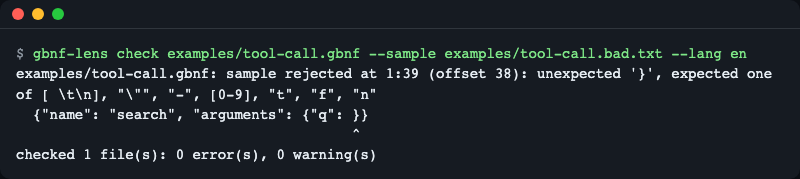
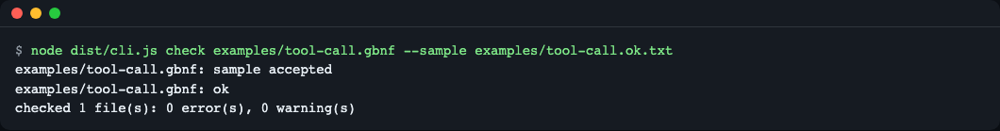
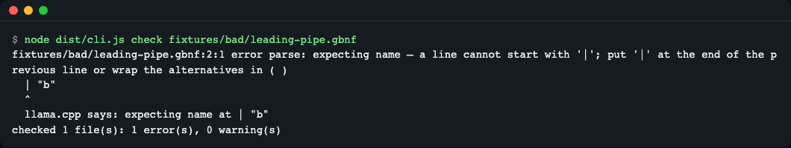
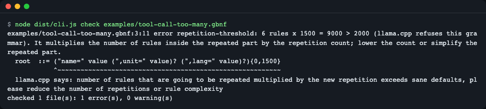
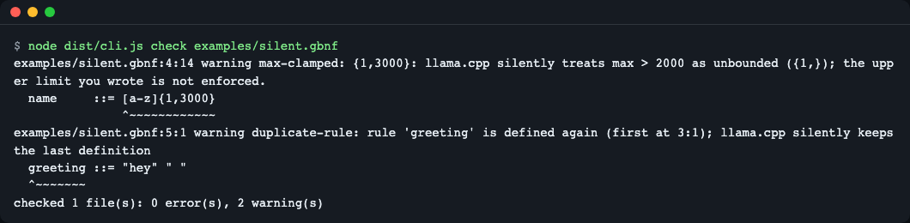
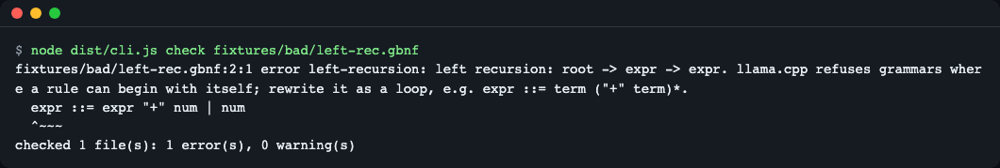
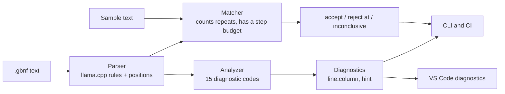

# gbnf-lens

**English** | [한국어](README.ko.md)

Check llama.cpp GBNF grammars (the grammar files that constrain what a local LLM may generate) in the terminal, in CI and in VS Code, before you send them to a server. gbnf-lens gives you a verdict that follows llama.cpp's own parse rules, line and column positions, warnings where llama.cpp silently changes the meaning of a grammar, and the exact spot where an example string stops matching. It is a zero-dependency TypeScript library, a CLI and a VS Code extension.


*A sample that does not match: the position (1:39), what the grammar expected instead, and a caret under the offending character.*

## What it adds

- **Positions for syntax errors.** llama.cpp prints a one-line message such as `expecting name at ...`. gbnf-lens shows `file:line:column`, the source line, a hint, and the original llama.cpp message.
- **Warnings for things llama.cpp accepts but does not do what you wrote.** A rule defined twice (the last one wins), `{m,n}` with `n` above 2000 (becomes unbounded), `x? x? x?` chains that can get slow, loops over something that can match nothing, and unused rules.
- **Errors for things llama.cpp refuses at load time.** Left recursion (shown as a rule path such as `root -> expr -> expr`), the repetition limit (rules inside the repeated part multiplied by the repeat count must stay at or below 2000), nesting that is too deep.
- **Sample matching.** Give it an example output and it tells you whether the grammar accepts it, or where and why it stops. Large repetitions are counted, not expanded, so `{0,2000}` costs no extra memory.
- **A library, a CLI and a VS Code extension** that share one core with no runtime dependencies.

Everything runs offline. No server, GPU, API key or network is needed.

## Why

llama.cpp reports a bad grammar as a single line without a position, for example `expecting name at ...` ([#11866](https://github.com/ggml-org/llama.cpp/issues/11866)). When a request is streamed, the error may not reach the client at all ([#7391](https://github.com/ggml-org/llama.cpp/issues/7391)). A tool-call grammar that goes over the repetition limit comes back as a server error ([#20867](https://github.com/ggml-org/llama.cpp/issues/20867)). gbnf-lens runs the same checks on your machine, before the request, and prints where the problem is.

## Requirements

| Part | Version I checked | Notes |
|---|---|---|
| Node.js | 26.13.0 and 20.20.2 (the package declares `>=20`; the full `npm test` suite passed on both on 2026-11-13, and CI runs Node 20 and 22) | Needed for the CLI, the library, and building the extension |
| npm | 11.20.0 and 10.8.2, the ones that ship with those Node versions | Dependencies are dev-only: TypeScript 7.0.2, esbuild 0.28.2, `@types/node` 26.6.6, `@types/vscode` 1.90.0 |
| VS Code | not verified in a real editor | The manifest declares `^1.90.0`. The extension logic is tested without VS Code (see [Limits](#limits)) |
| llama.cpp | commit `af6b524` | Only used as recorded reference output in `fixtures/llamacpp/cases.json`, never run by the tool |

## Install

gbnf-lens is not on npm yet. Install from a clone:

```bash
git clone https://github.com/LeeGyeongPil/gbnf-lens.git
cd gbnf-lens
npm install      # also builds dist/ and extension/dist/ through the "prepare" script
```

Check that it works:

```console
$ node dist/cli.js check examples/tool-call.gbnf
examples/tool-call.gbnf: ok
checked 1 file(s): 0 error(s), 0 warning(s)
```

To get a `gbnf-lens` command on your PATH, run `npm link` inside the clone. The examples below use `node dist/cli.js` so they work without it.

If you only want to see everything once, run the guided tour (5 steps, always exits 0):

```bash
npm run demo
```

## Usage

### Command line

```bash
node dist/cli.js check <files...> [--sample <file>] [--sample-text <text>] [--json] [--strict] [--max-steps <n>] [--max-input <n>] [--lang en|ko]
```

**Language.** Messages, help and the summary line come in English or Korean. The order is `--lang en|ko`, then the `GBNF_LENS_LANG` variable, then `LC_ALL`, `LC_MESSAGES` and `LANG`; a value that starts with `ko` gives Korean and anything else gives English. `--lang` can come before `check` (`--lang ko check ...`, `--lang=ko check ...`) or after it. A missing value, or one that is not `en` or `ko`, is a usage error (exit code 2) in either place, and the message names the `--lang` value (for example `--lang check x` gives `--lang needs 'en' or 'ko', got 'check'`). `code`, `severity` and the JSON keys never change, and the text after `llama.cpp says:` is llama.cpp's own and stays as it is. `--json` `message` follows the chosen language.

```bash
node dist/cli.js check grammar.gbnf --lang ko
GBNF_LENS_LANG=ko node dist/cli.js check grammar.gbnf
```

The examples below show English output; on a Korean locale add `--lang en` to get the same text.

| Exit code | Meaning |
|---|---|
| 0 | No errors (warnings are printed but do not fail the run) |
| 1 | Errors, or a rejected sample, or warnings when `--strict` is given |
| 2 | Usage error or a file that cannot be read |

**A clean grammar, and a sample it accepts.**

```console
$ node dist/cli.js check examples/tool-call.gbnf --sample examples/tool-call.ok.txt
examples/tool-call.gbnf: sample accepted
examples/tool-call.gbnf: ok
checked 1 file(s): 0 error(s), 0 warning(s)
```


*Exit code 0: nothing to fix.*

**A sample that stops matching** (exit code 1). The message gives the position, the code-point offset (the same counting llama.cpp's validator uses), and the set of things the grammar would have accepted there.

```console
$ node dist/cli.js check examples/tool-call.gbnf --sample examples/tool-call.bad.txt
examples/tool-call.gbnf: sample rejected at 1:39 (offset 38): unexpected '}', expected one of [ \t\n], "\"", "-", [0-9], "t", "f", "n"
  {"name": "search", "arguments": {"q": }}
                                        ^
checked 1 file(s): 0 error(s), 0 warning(s)
```

The value after `"q":` is missing, so the grammar expected whitespace, a string, a number, or `true`, `false`, `null`.

**A syntax error with a position** (exit code 1):

```console
$ node dist/cli.js check fixtures/bad/leading-pipe.gbnf
fixtures/bad/leading-pipe.gbnf:2:1 error parse: expecting name — a line cannot start with '|'; put '|' at the end of the previous line or wrap the alternatives in ( )
  | "b"
  ^
  llama.cpp says: expecting name at | "b"
checked 1 file(s): 1 error(s), 0 warning(s)
```


*llama.cpp says only `expecting name at | "b"`. The extra lines are the position and the fix.*

**The repetition limit** (exit code 1). llama.cpp multiplies the number of rules inside a repeated group by the repeat count and refuses the grammar above 2000. gbnf-lens computes the same number without expanding anything:

```console
$ node dist/cli.js check examples/tool-call-too-many.gbnf
examples/tool-call-too-many.gbnf:3:11 error repetition-threshold: 6 rules x 1500 = 9000 > 2000 (llama.cpp refuses this grammar). It multiplies the number of rules inside the repeated part by the repetition count; lower the count or simplify the repeated part.
  root  ::= ("name=" value (",unit=" value)? (",lang=" value)?){0,1500}
            ^~~~~~~~~~~~~~~~~~~~~~~~~~~~~~~~~~~~~~~~~~~~~~~~~~~~~~~~~~~
  llama.cpp says: number of rules that are going to be repeated multiplied by the new repetition exceeds sane defaults, please reduce the number of repetitions or rule complexity
checked 1 file(s): 1 error(s), 0 warning(s)
```


*6 rules x 1500 = 9000 is above the 2000 limit.*

**Accepted, but not what it looks like** (warnings, exit code 0):

```console
$ node dist/cli.js check examples/silent.gbnf
examples/silent.gbnf:4:14 warning max-clamped: {1,3000}: llama.cpp silently treats max > 2000 as unbounded ({1,}); the upper limit you wrote is not enforced.
  name     ::= [a-z]{1,3000}
               ^~~~~~~~~~~~~
examples/silent.gbnf:5:1 warning duplicate-rule: rule 'greeting' is defined again (first at 3:1); llama.cpp silently keeps the last definition
  greeting ::= "hey" " "
  ^~~~~~~~
checked 1 file(s): 0 error(s), 2 warning(s)
```


*llama.cpp loads this grammar without a word. The first rule `greeting` is thrown away, and `{1,3000}` is really `{1,}`.*

**Left recursion** (exit code 1), shown as the path of rules that leads back to itself:

```console
$ node dist/cli.js check fixtures/bad/left-rec.gbnf
fixtures/bad/left-rec.gbnf:2:1 error left-recursion: left recursion: root -> expr -> expr. llama.cpp refuses grammars where a rule can begin with itself; rewrite it as a loop, e.g. expr ::= term ("+" term)*.
  expr ::= expr "+" num | num
  ^~~~
checked 1 file(s): 1 error(s), 0 warning(s)
```


*The fix suggested in the message: turn the recursion into a loop.*

**For scripts and CI.** `--json` prints an array of `{file, line, column, endLine, endColumn, severity, code, message}`. `--strict` makes warnings fail the run:

```console
$ node dist/cli.js check examples/silent.gbnf --strict > /dev/null; echo "exit $?"
exit 1
$ node dist/cli.js check nope.gbnf; echo "exit $?"
gbnf-lens: cannot read 'nope.gbnf': ENOENT: no such file or directory, open 'nope.gbnf'
checked 1 file(s): 0 error(s), 0 warning(s)
exit 2
```

**A sample that is too long to check.** Sample matching stops at 100000 characters (code points) by default and says so, instead of guessing. Raise the limit with `--max-input`:

```console
$ node -e "console.log('a'.repeat(200000))" > long.txt
$ node dist/cli.js check examples/tool-call.gbnf --sample long.txt
examples/tool-call.gbnf: sample inconclusive: the sample is longer than 100000 characters (code points); raise --max-input to check it anyway
examples/tool-call.gbnf: ok
checked 1 file(s): 0 error(s), 0 warning(s)
```

`inconclusive` has three other causes, each with its own message: `--max-steps` ran out (raise it), the grammar recurses too deeply on this sample (deep right recursion; a longer budget does not help, so use a loop such as `x*`), and token terminals that need the model's vocabulary.

**An unclosed parenthesis** (exit code 1) points at the opening one:

```console
$ node dist/cli.js check fixtures/bad/unclosed.gbnf
fixtures/bad/unclosed.gbnf:3:7 error parse: expecting ')' to close the '(' opened at 3:7
  b ::= ( "y" | "z"
        ^
  llama.cpp says: expecting ')' at 
checked 1 file(s): 1 error(s), 0 warning(s)
```

A repeat count above 2^64-1 is a parse error too (`llama.cpp says: stoull`; read from the source, not run).

A GitHub Actions step is a single line once the repo is built: `node dist/cli.js check grammars/*.gbnf --strict`.

### Library

The package exports `lintGrammar`, `matchSample`, `parseGrammar`, `parseValidatorOutput` and `offsetToPosition`, as both ESM and CommonJS, with type declarations. I ran this file from inside the clone, where the package name resolves to itself:

```js
import { lintGrammar, matchSample } from "gbnf-lens";

const grammar = 'root ::= "a" digits\ndigits ::= [0-9]{1,3000}\n';
for (const d of lintGrammar(grammar)) {
  console.log(`${d.start.line}:${d.start.column} ${d.severity} ${d.code}`);
}
console.log(matchSample('root ::= "a" [0-9]+\n', "a12x"));
```

Output:

```text
2:12 warning max-clamped
{
  status: 'reject',
  reason: 'unexpected-char',
  at: { offset: 3, line: 1, column: 4 },
  expected: [ '[0-9]' ]
}
```

Pass `{ lang: "ko" }` as the options argument (`lintGrammar(text, { lang: "ko" })`, also `parseGrammar` and `matchSample`) to get Korean messages; the default is English, and the type of the option is exported as `Language` (`"en" | "ko"`). Other values do not throw: a string that starts with `ko` (such as `"ko-KR"` or `"KO"`) gives Korean, and anything else (such as `"fr"` or `"EN"`) gives English.

`lintGrammar` never throws for bad grammar text (it returns diagnostics) and throws `TypeError` only when the argument is not a string. `matchSample` returns one of `accept`, `reject`, `grammar-error`, or `inconclusive` (the step budget or the input limit was exceeded, the grammar recurses too deeply on this sample, or it uses token terminals such as `<[1000]>` that need the model's vocabulary).

### VS Code extension

The extension lives in `extension/` and is not published to any marketplace. It adds the `.gbnf` language with highlighting, live diagnostics (the same ones the CLI prints, shown as squiggles with the llama.cpp message as related information), go to definition from a rule reference, and the command **GBNF: Check Sample Against Grammar**. Command titles, notifications and diagnostic messages follow the VS Code display language (Korean when it starts with `ko`, English otherwise); `llama.cpp says:` text stays as it is. For that command, select the sample text in the editor and run it; with no selection it asks you for a file.

To try it from source:

1. `npm install` in the clone (builds `extension/dist/extension.js`).
2. Open the `extension/` folder in VS Code and press F5 to start an Extension Development Host, or run `code --extensionDevelopmentPath=<path to the clone>/extension`.
3. Open any `.gbnf` file in that window.

This path was not run in a real VS Code. See [Limits](#limits).

## Settings

There are no settings. The CLI options are listed above; `--max-steps <n>` (default 5000000) limits the work the sample matcher may do, and `--max-input <n>` (default 100000 code points) limits the sample length, before it answers `inconclusive`.

## Checks

Every diagnostic has a `code` (the `--json` field, also exported as `DIAGNOSTIC_CODES`). Errors fail the run, warnings fail it only with `--strict`, info never fails it.

| Code | Severity | What llama.cpp does with this grammar | Example |
|---|---|---|---|
| `parse` | error | Refuses it; stops at the first syntax error | a line starting with `\|` |
| `undefined-rule` | error | Refuses it | `root ::= a` with no `a` |
| `no-root` | error | Refuses it | no rule named `root` |
| `left-recursion` | error | Refuses it | `expr ::= expr "+" num` |
| `repetition-threshold` | error | Refuses it when rules inside the repeat x count exceeds 2000 | `(a b? c?){0,1500}` |
| `repetition-min-too-large` | error | Refuses it when the minimum is above 2000 | `"a"{2001}` |
| `repetition-range` | error | `{5,2}` (max below min): would not finish, from reading the source, **not confirmed with the binary** | `"a"{5,2}` |
| `nesting-depth` | error | Refuses parentheses nested more than 256 deep | 257 nested `(` |
| `duplicate-rule` | warning | Silently keeps the last definition | `greeting` defined twice |
| `max-clamped` | warning | Silently treats `{m,n}` with n above 2000 as `{m,}` | `[a-z]{1,3000}` |
| `nullable-loop` | warning | Accepts it; a loop over something that can match nothing makes the grammar ambiguous and slow | `("a"?)*` |
| `optional-chain` | warning | Accepts it; three or more identical optional items in a row can be very slow | `x? x? x?` |
| `unused-rule` | warning | Accepts it; the rule is never reached from `root` | a helper nobody calls |
| `large-repetition` | info | Accepts it, but builds about 500 or more rules, so loading is slower | `"a"{0,2000}` |
| `token-needs-vocab` | info | Accepts it; whether text matches depends on the model's vocabulary, so samples cannot be judged | `<[1000]>` |

Severity values come from the source (`src/types.ts`) and from running each case under `fixtures/bad/`.

## How it works



- **Parser.** A recursive-descent parser that reads the grammar in the same order as llama.cpp and stops at the first syntax error, as llama.cpp does. It keeps the position of every node.
- **Analyzer.** Looks for undefined rules, a missing `root`, left recursion, the repetition limit, and the silent-change warnings. The repetition cost is computed with arithmetic while parsing, so nothing is expanded.
- **Matcher.** Remembers which positions each rule can reach, counts repetitions instead of unrolling them, and stops with `inconclusive` rather than hanging when the input or the work is too large.
- **Where the llama.cpp comparison comes from.** 14 recorded outputs of llama.cpp's `test-gbnf-validator` (CPU build of commit `af6b524`, taken 2026-11-11) are stored in `fixtures/llamacpp/cases.json`. A test checks that gbnf-lens reaches the same verdict on all 14. This is a recording, not a live run. The tool never starts llama.cpp.
- **Access.** The extension only reads the open `.gbnf` document and, for the sample command, a file you pick. It makes no network calls.

Official grammars used as test data come from llama.cpp (MIT licence, notice in `fixtures/grammars/LICENSE-llama.cpp`).

## Compared with

Checked on 2026-11-11. Only what I observed is listed.

| Tool | Version | What I observed |
|---|---|---|
| [gbnf-highlighter](https://github.com/iddar/gbnf-highlighter) (VS Code) | not run | Syntax colouring and comment toggling; no diagnostics, go to definition or sample matching |
| llama.cpp `test-gbnf-validator` | commit `af6b524` | The reference verdict, but it needs a llama.cpp build and prints no line and column for grammar errors |
| [`gbnf`](https://www.npmjs.com/package/gbnf) on npm | 0.1.41 | The `require` entry point failed to load; the official `json.gbnf` and `json_arr.gbnf` failed to parse; `{m,n}` unsupported |
| [`@tabnas/gbnf`](https://www.npmjs.com/package/@tabnas/gbnf) on npm | 0.2.1 | Parsed the 8 official grammars; accepted a `\|` at the start of a line and left recursion, which llama.cpp refuses; `{0,1500}` and `{0,3000}` ran past a 1 GB heap |

## When to use it

- Good fit: you write GBNF by hand for llama.cpp-family servers and want errors with positions and warnings before you start the server; you want a CI step that fails on a grammar llama.cpp would refuse.
- Not a fit: it does not run a model, does not generate text, and does not know your model's vocabulary, so grammars with token terminals can be linted but their samples cannot be judged.
- Other tools: to turn a JSON Schema into a grammar, see the converter that ships with [llama.cpp](https://github.com/ggml-org/llama.cpp); to colour GBNF in an editor only, see [gbnf-highlighter](https://github.com/iddar/gbnf-highlighter); to confirm llama.cpp's own verdict, run its `test-gbnf-validator`.

## Limits

- **VS Code is unverified.** The extension's logic (`extension/src/features.ts`) is tested without VS Code: diagnostic ranges in UTF-16 columns, go to definition, the manifest fields, and that `vscode` is kept external in the bundle. The thin adapter that connects it to the editor (`extension/src/extension.ts`) and the run-from-source steps above were not tried in a real editor.
- **Token terminals** (`<name>`, `<[id]>`) need the model vocabulary. Sample matching answers `inconclusive`.
- **Recorded comparison.** The 2000 and 256 limits and the other behaviours match llama.cpp commit `af6b524`; upstream may change them.
- **First error only.** Like llama.cpp, parsing stops at the first syntax error, so later ones show up after you fix it.
- **`repetition-range`** (`{5,2}`, max below min) is derived from reading llama.cpp's source, not from running its binary. The message says "would not finish" for that reason.
- **Very deep right recursion** on a long sample can exhaust the JavaScript stack; the answer is then `inconclusive`.
- **Sample length.** Samples longer than 100000 code points are not checked unless you raise `--max-input`; the answer is `inconclusive` with a message saying so.
- **Large repeat counts lose precision.** Numbers above 2^53 in a `{m,n}` are read as JavaScript numbers and rounded; the limits that matter (2000 and 256) are far below that, but the reported count can be off for absurd values.
- **Long sample lines are printed whole.** When a sample is rejected, the offending line is printed in full, with no truncation, so one very long line fills the terminal.
- **Test files in subfolders are not found.** `scripts/run-tests.mjs` lists only the top level of `test/`.
- **Unreadable file summary.** When a grammar file cannot be read, the summary line wording is not specific about it.
- **npm warning.** Newer npm versions may print an `install-scripts ... allowScripts` warning for esbuild; the build still succeeds.
- **Not yet built:** `--oracle` (run a local validator side by side), hover, find references, a `.vsix` package, a formatter.

## Troubleshooting

| Symptom | Cause | Fix |
|---|---|---|
| `Cannot find module .../dist/cli.js` | The project was not built | Run `npm install` (it builds) or `npm run build` |
| `unknown command 'check ...'` | The whole command was passed as one quoted argument | Write `check` and the file as separate words |
| Exit code 2 and `cannot read '...'` | The file path is wrong | Check the path; it is relative to where you run the command |
| Exit code 2 and `--lang needs 'en' or 'ko'` | `--lang` has no value or another value (`fr`, `ko-KR`) | Use `--lang en` or `--lang ko`; for locale-style values use `GBNF_LENS_LANG` or `LANG` |
| Sample `inconclusive` with `needs vocab` | The grammar has token terminals | Use a grammar without tokens for the sample check, or check the sample against the model itself |
| Sample `inconclusive` with `longer than 100000 characters` | The sample is over the input limit | Pass `--max-input <n>` with a larger number |
| Squiggles do not appear in VS Code | The file is not recognised as GBNF, or the extension is not loaded | Use the `.gbnf` extension and check the language mode in the status bar |

## Development

```bash
npm install
npm test          # builds, then runs the whole suite; it passed if the summary shows "fail 0"
npm run demo      # the five-step tour
npm run typecheck
```

The tests include the 14-case comparison with the recorded llama.cpp output, the eight official llama.cpp grammars, a run of the CLI under a 64 MB heap, and the ESM and CommonJS entry points.

See [CHANGELOG.md](CHANGELOG.md) for changes.

## License

MIT.
